# production-orders-service

[](https://github.com/santoshmyakala/production-orders-service/actions/workflows/ci.yml)


A production-order service for a manufacturing plant, in **Java 21 and Spring Boot 4**. Planners create orders and release them to a line once the ERP has reserved the material; operators start and complete them on the shop floor.

The domain is deliberately small. The point is **the production concerns around it**:
- **Correctness:** a retried request never plans production twice, and two people cannot overwrite each other's change unseen.
- **Consistency:** a state change and its event commit together.
- **Resilience:** a failing ERP cannot take the service down with it.
- **Operations:** the service is observable and safe to run on Kubernetes.

It is the kind of workload the [Azure hybrid manufacturing platform](https://github.com/santoshmyakala/azure-hybrid-manufacturing-platform) hosts in its application spoke. Its manifests pass the [guardrails webhook](https://github.com/santoshmyakala/k8s-guardrails-webhook).

<picture>
  <source media="(prefers-color-scheme: dark)" srcset="docs/diagrams/architecture-dark.svg">
  
</picture>

<sub>Animated diagrams generated from <a href="docs/diagrams/diagrams.yaml">docs/diagrams/diagrams.yaml</a> with <a href="https://github.com/santoshmyakala/santoshmyakala/tree/main/tools/archdiagram">archdiagram</a>.</sub>

## API

| Method | Path | Role | Notes |
|---|---|---|---|
| `POST` | `/api/orders` | planner | Plans an order. `Idempotency-Key` header recommended |
| `GET` | `/api/orders/{id}` · `/api/orders?status=&line=&page=&size=` | viewer, planner, operator | `ETag` = order version. Page size ≤ 200 |
| `POST` | `/api/orders/{id}/release` | planner | Reserves material in the ERP, then `PLANNED → RELEASED` |
| `POST` | `/api/orders/{id}/start` | operator | `RELEASED → IN_PROGRESS` |
| `POST` | `/api/orders/{id}/complete` | operator | `IN_PROGRESS → COMPLETED` with good and scrap quantities |
| `POST` | `/api/orders/{id}/cancel` | planner | Only from `PLANNED` or `RELEASED`: an order on the line can't be cancelled |

All state changes accept `If-Match`. Errors are **RFC 9457 problem details** with a stable `type`:

| Problem | HTTP | Meaning |
|---|---|---|
| `validation-failed` | 400 | Every invalid field listed in `errors` |
| `invalid-transition` | 409 | The lifecycle doesn't allow this change |
| `stale-version` | 412 | `If-Match` doesn't match: someone else changed the order |
| `idempotency-key-reused` | 422 | Same key, different request |
| `insufficient-material` | 409 | The ERP has too little stock: a business answer, not retried |
| `material-service-unavailable` | 503 + `Retry-After: 30` | The ERP is down or the circuit is open; the order is unchanged |

## Design decisions

| Concern | Decision |
|---|---|
| **Retries don't duplicate production** | `Idempotency-Key` is stored with a SHA-256 of the request, in the same transaction as the order. A retry returns the original order (`Idempotent-Replayed: true`); the same key with a different body gets 422. Concurrent retries race on the key's primary key, and the loser returns the winner's order |
| **No lost updates** | JPA `@Version` is exposed as the `ETag`. Clients send `If-Match`: a stale write gets 412, and a write that races in the same instant gets 409 |
| **Events can't be lost or invented** | **Transactional outbox**: the event row commits with the state change. A relay publishes in order with `FOR UPDATE SKIP LOCKED`, so several replicas can relay without double-publishing a batch. A row is marked published only after the broker accepts it: at-least-once, deduplicated on `event_id` |
| **The ERP is outside the transaction** | Material is reserved **before** the database transaction, so a slow ERP never holds a connection. The reservation is keyed by order number, so a retried release reuses it |
| **A failing ERP stays contained** | Resilience4j with a 1 s connect and 2 s read timeout, 3 attempts with exponential backoff (5xx and I/O errors only), and a circuit breaker (≥ 50% failed or slow calls among the last 10, minimum 5 → open for 30 s). "Insufficient material" is neither retried nor counted as a failure. The breaker's state is deliberately **not** in the health check: an ERP outage must not make Kubernetes restart this service |
| **Least privilege** | OAuth2 resource server: a JWT from the company IdP (Entra ID, Keycloak…), with roles from the `roles` claim. Planners plan, operators run the line, viewers read. Stateless, so no sessions or CSRF tokens |
| **The database protects itself** | Flyway owns the schema (Hibernate only validates). Check constraints mirror the domain, e.g. a released order must have a reservation. Every connection has a 5 s `statement_timeout` |
| **Operable** | Virtual threads; graceful shutdown with a `preStop` drain; liveness and readiness on a separate **management port 8081**, not routed by the ingress; Prometheus metrics; ECS JSON logs |

## A bug the tests caught

The concurrency test sends 8 simultaneous requests with one `Idempotency-Key`. The first version created **two** orders.

`IdempotencyKey` has an assigned primary key and no version field, so Spring Data's `save()` treated the losing request's key as an *existing* entity. It issued a `merge`, which silently **overwrote** the winner's key row instead of failing on the primary key.

The fix is to implement `Persistable` with `isNew() == true`, so a key is always `INSERT`ed and the race is detected. The test has passed in every run since (5 local runs so far).

## Observability

| Metric | Use |
|---|---|
| `http_server_requests_seconds_bucket` | Latency SLOs per endpoint (histograms enabled) |
| `orders_planned_total{line}` · `orders_transitions_total{to}` | Business throughput per line and state |
| `orders_outbox_pending` | Events not yet published; alert if it keeps growing |
| `orders_outbox_published_total` · `orders_outbox_publish_failures_total` | Relay health |
| `resilience4j_circuitbreaker_state{name="erp"}` · `resilience4j_retry_calls_total` | ERP dependency health |

## Tests

```bash
mvn verify   # needs Docker for Testcontainers
```

There are **22 tests**, with **92% line coverage** (JaCoCo).

**Unit tests:**
- the order lifecycle;
- `If-Match` parsing.

**Integration tests: the whole service against real PostgreSQL 17 (Testcontainers) and a real HTTP stub of the ERP**, so timeouts, retries and the breaker run for real:
- planning and reading back; validation listing every field; role enforcement (401/403);
- idempotent replay, reused-key rejection, and **8 concurrent retries → exactly one order**;
- releasing reserves material with an idempotency key and records `Planned` and `Released` events;
- insufficient material: no retry, and no breaker failure;
- ERP 503: exactly 3 attempts, then 503 with `Retry-After`, order unchanged;
- a slow ERP is cut off by the read timeout;
- **the circuit opens and further releases don't call the ERP at all**;
- the shop-floor lifecycle with a stale `If-Match` (412) and invalid transitions (409);
- search and pagination limits;
- the outbox relay publishes each event exactly once;
- probes and business metrics are exposed.

## Container and Kubernetes

The [`Dockerfile`](Dockerfile) builds once on the native platform, extracts Spring Boot's layers and runs on **distroless Java 21 as UID 65532**. Dependencies are their own layer, so a code change ships about 300 KB.

The runtime image was tested locally with a read-only root filesystem, all capabilities dropped and `no-new-privileges`. It migrates the schema, reports ready and shuts down gracefully.

[`deploy/`](deploy) has the kustomize manifests:
- 3 replicas spread across zones, a PDB (`minAvailable: 2`) and `maxUnavailable: 0`;
- startup, liveness and readiness probes on the management port;
- `preStop` sleep, read-only root filesystem with an in-memory `/tmp`, and no service-account token;
- the FinOps labels, requests and memory limit the guardrails require.

## Delivered by GitHub Actions

<picture>
  <source media="(prefers-color-scheme: dark)" srcset="docs/diagrams/github-actions-dark.svg">
  
</picture>

- [`ci.yml`](.github/workflows/ci.yml):
  - `mvn verify` with Testcontainers, with test and coverage summaries;
  - kustomize + kubeconform;
  - image build + Trivy;
  - gitleaks.
- [`release.yml`](.github/workflows/release.yml) runs **only after `ci` succeeded** on `main` or a `v*` tag, from the tested commit. It publishes `linux/amd64` + `linux/arm64` to GHCR with SBOM and provenance, **signed by digest with cosign (keyless)**.

## Run locally

```bash
docker run -d --name orders-db -e POSTGRES_DB=orders -e POSTGRES_USER=orders -e POSTGRES_PASSWORD=local-dev-only -p 5432:5432 postgres:17-alpine
DATABASE_PASSWORD=local-dev-only OIDC_ISSUER_URI=https://<your-idp>/ mvn spring-boot:run
```

## Licence

MIT
